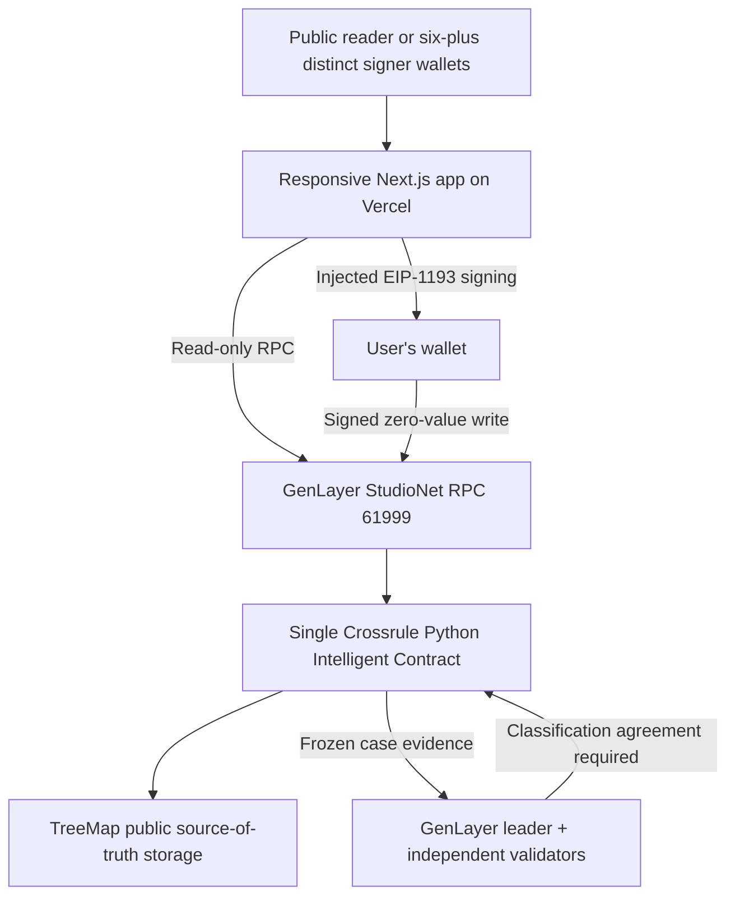
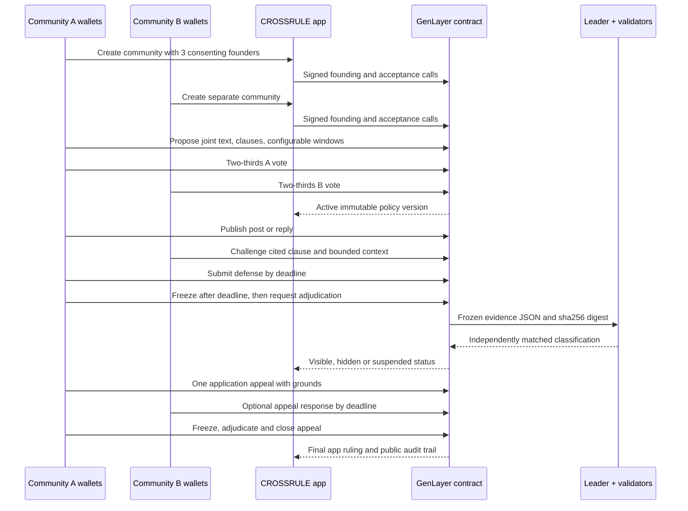
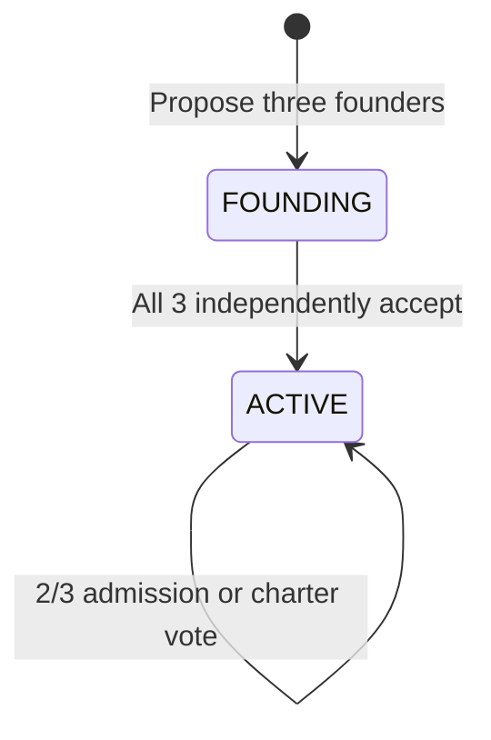
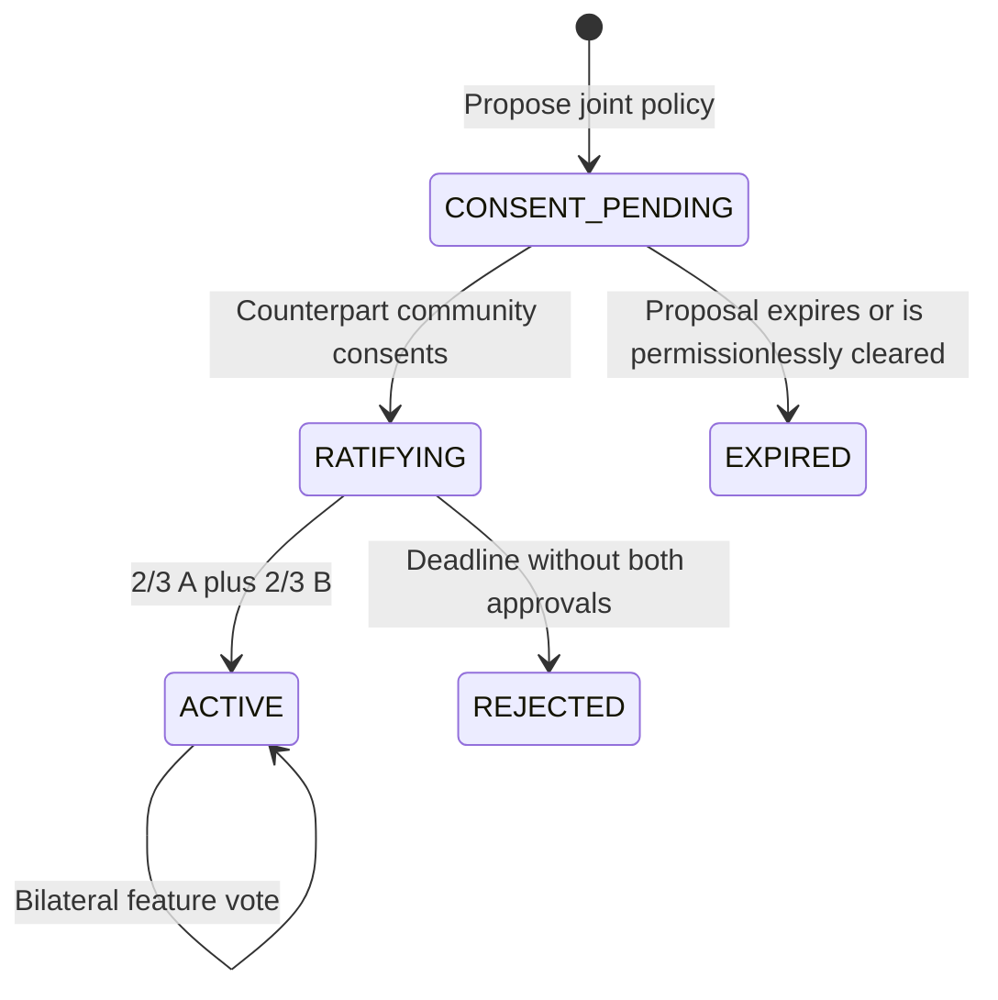

# CROSSRULE — Architecture and state model

## Trust boundaries

Everything outside `Crossrule.py` is a presentation or transport layer. No service holds a privileged key, adjudicates cases, starts timers, or can change authoritative outcomes. Case and policy data are inspectable using public contract view methods. The browser's local transaction history is **convenience only**, never a source of authority.

## Roles

| Actor | Key permissions / limits |
| --- | --- |
| Anonymous visitor | Browse communities, rooms, public posts, cases, agreement versions, source status; cannot write |
| Founder | Propose a community; invited founders must independently consent before activation |
| Community member | Vote on admissions and charter amendments; propose and vote on cross-community agreements; join room discussions |
| Other member in room | Cite a clause and challenge a visible/under-review eligible post once |
| Challenged author | File one defense before cutoff; if adversely ruled against, file one appeal |
| Reporter | File a challenge; when a case rejects the complaint, appeal that decision once; respond to the author's appeal |
| Any transaction submitter | Finalize sufficiently approved/expired votes; freeze an expired defense, adjudicate a frozen case, close an unappealed case |
| GenLayer validators | Independently re-evaluate frozen evidence; veto classification disagreement |

The contract has no administrator. No wallet has elevated authority over either group's decisions.

## Complete product sequence

## Storage model

The one contract stores ordered JSON records inside GenLayer `TreeMap` primitives. No external indexer is authoritative.

| Store | Key / fields | Core invariants |
| --- | --- | --- |
| `communities` | Monotonic ID; name, description, founders, consents, members, versioned charters, active votes | 3 consenting founders, 12-member cap, two-thirds charter/admission threshold, 1 active vote per type |
| `rooms` | Monotonic ID; two community IDs, consent/votes, status, agreement policy snapshots, version, post count, feature vote | Distinct community IDs; disjoint member rosters; counterpart consent before ratification; separate two-thirds threshold each side |
| `posts` + `room_post_index` | Monotonic global ID plus `${roomId}:${ordinal}` → post ID index | Author/parent remain stable; deterministic bounded pages; hidden means hidden from app feed, not erased; no lifetime room cap |
| `cases` | Monotonic ID; frozen clause, agreement version, context, author, reporter, defense, decision, appeal | One challenge per post; immutable evidence inputs hashed before LLM call; one app appeal |
| `restrictions` | `${roomId}:${lowercaseWallet}` with case IDs and expiry timestamps | Case-scoped suspension only on allowed serious breaches; reversal removes its own entry; upheld appeal preserves original expiry |

### Community state

Founding is explicitly opt-in. An unaccepted founder remains a pending invitation, never a member. The initial founder set is fixed; there is no community-level admin or privileged removal. Community admission is separately consented to by the invitee and ratified by two-thirds of the current roster snapshot. Votes do not double count and expire at their immutable deadlines.

### Room governance state

An active room may have a pending amendment while ordinary posts and cases continue under the active policy. Amendments affect **newly opened cases**; a case retains the frozen agreement and sanctions from the version that existed when it was filed. Earlier policies remain in `policies` for audit.

### Case state and effects

```mermaid
stateDiagram-v2
  [*] --> OPEN: Other member files clause-based challenge
  OPEN --> FROZEN: Defense deadline expires; hash evidence
  FROZEN --> DECIDED: GenLayer semantic ruling
  DECIDED --> CLOSED: Appeal deadline passes
  DECIDED --> APPEAL_OPEN: Adverse party files one appeal
  APPEAL_OPEN --> APPEAL_FROZEN: Response deadline expires
  APPEAL_FROZEN --> CLOSED: Reassessment and final app ruling
```

Case decisions classify evidence, not human identity. The only accepted outputs are four enumerated findings. They must cite the challenged clause ID, contain a non-whitespace exact extract from the specific frozen post (1–180 UTF-8 bytes), and include a bounded reason. The validator re-runs semantic assessment independently; mismatched classifications fail, rather than quietly registering an unreliable ruling. Both `original_decision` and `original_finding` remain stored after an appeal; the current `decision` and `finding` reflect its later result, and the appeal's own decision is retained as well. A one-byte or short Unicode post may use the complete post as its materially relevant anchor.

- `NO_VIOLATION`: post `VISIBLE` or `RESTORED`; no suspension.
- `INSUFFICIENT_EVIDENCE`: post `VISIBLE` or `RESTORED`; no suspension.
- `MINOR_BREACH`: post `HIDDEN`; no suspension.
- `SERIOUS_BREACH`: only if the ratified clause has `max_severity=SERIOUS`; post `HIDDEN` and case-scoped temporary room posting suspension.

The system does **not** delete the on-chain text. The application does not conceal a public, challenged post's provenance from contract readers. A post has one finality-bound challenge: after a case exists, even a restored post cannot be challenged again. Restoration restores visibility only; it never silently restores a previous featured endorsement. A fresh bilateral feature vote is required.

### Bounded relationship and proposal indexes

Admission does not scan historical rooms. The contract maintains a direct `wallet_conflict_index` keyed by lowercase wallet and community, plus `community_partner_index` and `pair_reservation_counts` for active bilateral relationships. On admission, only currently indexed active partners are checked, so unrelated communities and rejected room history do not increase the work of a member admission. Index updates occur in the same transaction as authoritative membership/room transitions; failed writes revert together with the index mutation.

Room proposals are bounded by a pair key and a global pending counter. A proposer creates `CONSENT_PENDING`; only a member of the counterpart community can call `consent_room`. The two frozen rosters are then voted independently. Duplicate pending pairs, expired proposals and capacity overflow are rejected, while `expire_room_proposal` provides permissionless, state-validated cleanup. Existing active rooms and their reservations are not rewritten by a failed proposal.

Posts use a monotonic global ID and a room-scoped ordinal index. `list_posts(room, offset, count)` accepts at most 20 records per read and never copies the full room history. This preserves post IDs, replies, evidence and featured references indefinitely within the contract's available storage while keeping each read and write bounded. Direct Mode covers the former 150-post boundary and pagination beyond it; the live demonstration verifies stable pages over six real posts.

## All configured time windows

| What expires | Who sets it | When frozen | Range |
| --- | --- | --- | --- |
| Community admission / charter vote | Founder in community setup | Community creation | 2–10,080 minutes |
| Joint agreement and amendment votes | Room proposer | Each proposal | 2–10,080 minutes |
| Featured-post vote | Inherits ratified joint vote time | Feature proposal | 2–10,080 minutes |
| Case defense | Joint policy proposer, both groups ratify | Case opening, policy snapshot | 2–10,080 minutes |
| Eligibility to open one case appeal | Joint policy proposer, both groups ratify | Initial case decision | 2–10,080 minutes |
| Appeal response | Ratified defense duration | Appeal creation | 2–10,080 minutes |
| Serious-posting sanction | Joint policy proposer, both groups ratify | First serious ruling | 2–10,080 minutes |

All four joint-policy inputs appear in the **frontend** and can be shortened for demos; they are not globally hardcoded. **No UI setting controls GenLayer network consensus or protocol finality**, and on-chain timestamps continue even if a wallet or browser goes offline. Advancing an eligible case stage requires a normal wallet-submitted transaction; there is deliberately no keeper.

## RPC and UI behavior

The web app connects to `https://studio.genlayer.com/api` and GenLayer's StudioNet chain 61999. Public screens use finalized contract view reads. Write buttons request wallet connection/network switch and transaction signature from the user, submit zero native-value calls, and surface the transaction hash and finalized state, not an invented success. The contract address is provided at build time through `NEXT_PUBLIC_CROSSRULE_CONTRACT_ADDRESS`; the app distinguishes unconfigured source preview from deployment.

The public first screen is the Accord Chamber landing page. Its bilateral SVG diagram is explicitly illustrative and labeled as not live chain state; the public counts, communities, rooms and cases beneath it are read from the deployed contract. Entering the application exposes the full operational workspace, including governance forms, policy archives, case files, appeal controls and transaction history. This separation keeps the product story distinct from the write-oriented dashboard without adding a second authority or data store.

The browser has no private-key imports, mnemonic field, secret-bearing server routes, privileged API keys, backend proxy, or database. Public on-chain data is intentionally public; do not paste private material into evidence or defense fields.

## Contract method map

| Area | Public write methods | Public view methods |
| --- | --- | --- |
| Founding and membership | `create_community`, `accept_foundership`, `propose_member`, `accept_membership`, `vote_member`, `finalize_member` | `get_community`, `list_communities` |
| Charter governance | `propose_charter`, `vote_charter`, `finalize_charter` | `get_community` |
| Bilateral policy | `propose_room`, `consent_room`, `expire_room_proposal`, `propose_amendment`, `vote_agreement`, `finalize_agreement` | `get_room`, `list_rooms` |
| Featured content | `propose_feature`, `vote_feature`, `finalize_feature` | `get_room`, `get_post` |
| Discussion | `publish_post` | `get_post`, `list_posts` (bounded pages of at most 20) |
| Cases | `open_case`, `submit_defense`, `freeze_case`, `adjudicate_case`, `close_case` | `get_case`, `list_cases` |
| Appeals | `open_appeal`, `submit_appeal_response`, `freeze_appeal`, `adjudicate_appeal` | `get_case` |
| Restrictions and counts | — | `get_restriction`, `get_counts` |

## Deployed record used for review

The current source-matched StudioNet deployment at `0xD7510Ee01F9A922D0808f5160f83C96C491cc2Ab` reads three active communities, one active room, six posts and four cases. The active room preserves policy versions 1–3; case 1 is a closed `NO_VIOLATION`, and cases 2–4 are serious findings with preserved original/appellate records where appealed. These are public records, not frontend fixtures. See [`LIVE_EVIDENCE.md`](LIVE_EVIDENCE.md) for transaction-level provenance.

The deployed source was validated by the genuine GenVM linter as 38 methods: 10 views and 28 writes. `Crossrule.py` is the only authoritative state transition layer. The web app cannot manufacture a community, policy, case, receipt or adjudication result.

## Deployment provenance

The current StudioNet address and finalized deployment/readback ledger are in [`LIVE_EVIDENCE.md`](LIVE_EVIDENCE.md). The source parity check decodes the deployment transaction's returned `data.contract_code` and compares it byte-for-byte with the committed contract source. Vercel serves the client build from the `frontend` project root and injects only the public contract address.

## Design tradeoffs already decided

- Fixed two-community bilateral agreements, not N-way governance.
- One contract, no proxy or upgrade path.
- Permissionless finalization calls rather than an automatic cron agent.
- Text-only public posts with bounded length, bounded page reads and stable room-scoped storage indexes.
- Auditable immutable rule/case snapshots rather than mutable moderation policy links.
- Two-stage original ruling plus one app appeal, not unlimited appeals.
- Versioned community charters and joint policy amendments in this complete scope.
- No tokens, fund custody, sybil resistance assertions, or real-world identity verification.

These are explicit complete-product boundaries; do not quietly reclassify them as deferred mandatory features.
